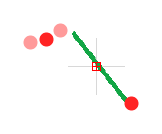

# retas-patches

**Stylos 旋转缩放中割对位 · Rotation and scale inbetween alignment · Stylos 回転・拡縮を伴う中割りの位置合わせ**

[下载 v0.1 / Download v0.1 / v0.1 をダウンロード](https://github.com/kevin-zf1123/retas-patches/releases/download/v0.1/Stylos-Inbetween-x86.zip)

## 中文

在 32 位 Windows 版 RETAS STUDIO Stylos 2.6 的透光台上，依次在两张原画上各点两个对应特征，即可按指定中割比对位。预览时拖动所选原画的红点，两张参考图会同步调整，当前中割画纸保持原位。

关闭 Stylos，先备份本机的 `Stylos.exe`。解压下载的 ZIP，运行 `StylosInbetween.exe`，选中原安装目录的主程序。安装后继续用原来的快捷方式启动。需要 .NET Framework 4.5 或更高版本。[中文使用与构建说明](stylos/rotation-scale-inbetween/README.zh-CN.md)

## English

Pick two matching features on each key drawing in the light table of RETAS STUDIO Stylos 2.6 for 32-bit Windows. Stylos aligns both references at the specified inbetween fraction while the drawing you are working on stays in place. Drag a red point on the selected reference to refine the fit live.

Close Stylos and back up your installed `Stylos.exe`. Extract the ZIP, run `StylosInbetween.exe`, and select that executable. You can keep using your existing launcher. Installation requires .NET Framework 4.5 or later. The patch UI is in Simplified Chinese. [English usage and build guide](stylos/rotation-scale-inbetween/README.md)

## 日本語

32 ビット Windows 版 RETAS STUDIO Stylos 2.6 のライトテーブルで、前後の原画から対応する点を 2 点ずつ指定すると、中割りの比率に合わせて両方の原画を重ねられます。編集中の動画用紙はそのままです。プレビューでは、選んだ原画の赤い点をドラッグして位置合わせを微調整できます。

Stylos を終了し、使用中の `Stylos.exe` をバックアップしてください。ZIP を展開して `StylosInbetween.exe` を起動し、インストール先の `Stylos.exe` を選びます。適用後も従来のショートカットを使えます。.NET Framework 4.5 以降が必要です。パッチの画面表示は簡体字中国語です。[日本語の使い方とビルド手順](stylos/rotation-scale-inbetween/README.ja.md)

